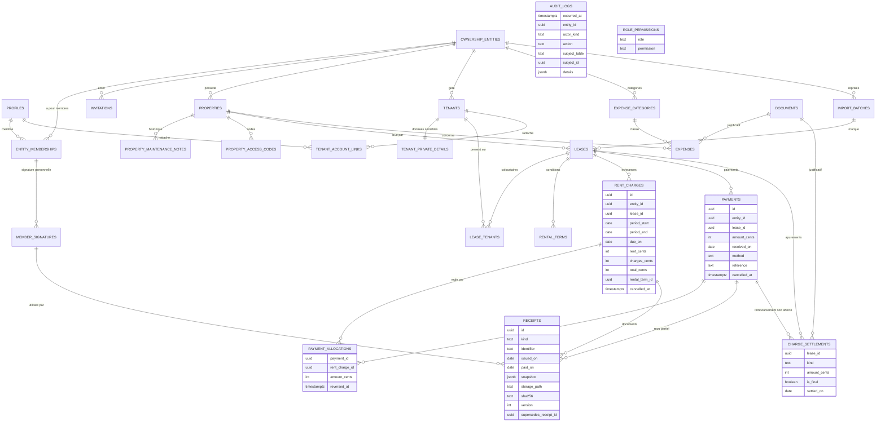
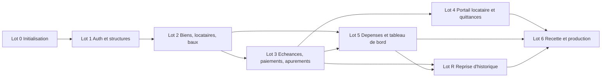

# Proposition initiale — Application de gestion locative

**Statut : proposition à valider. Aucun code applicatif n'a été écrit.** Ce document répond au livrable initial du README §17. Il est assemblé à partir des 14 tickets de la carte wayfinder ([docs/wayfinder/map.md](wayfinder/map.md)), qui gardent le détail de chaque décision et sa justification. En cas d'écart entre ce document et un ticket, le ticket fait foi ; signalez-le pour que ce document soit corrigé.

Vocabulaire : [GLOSSARY.md](../GLOSSARY.md). Décisions difficiles à renverser : [docs/adr](adr). Recherches sources : branches `research/cadre-legal-quittances` et `research/rgpd-et-hebergement` (jamais fusionnées).

## Sommaire

1. Synthèse et hypothèses
2. Architecture technique
3. Modèle relationnel
4. Migrations initiales
5. Matrice des autorisations
6. Parcours utilisateurs
7. Règles métier financières
8. Quittances, reçus et signature
9. Tableau de bord
10. Apurement des charges et reprise d'historique
11. Stratégie de test
12. Backlog priorisé et dépendances
13. Risques
14. Écarts avec le README, jalons et points à valider

---

## 1. Synthèse et hypothèses

Application web de gestion locative en français, multi-propriétaires, avec un espace propriétaire (patrimoine, baux, loyers, paiements, dépenses, quittances, tableau de bord) et un espace locataire limité à ses quittances et à ses informations. Monolithe modulaire Next.js sur Supabase et Vercel, avec règles financières et contrôles d'accès vérifiables par des tests.

**Périmètre** : baux d'habitation, vides ou meublés, charges en provisions. Hors périmètre : intégration bancaire, relances automatiques par e-mail, signature électronique des baux, comptabilité complète, déclaration fiscale, calcul automatique des révisions de loyer, régularisation avancée des charges, application mobile native, microservices, baux non résidentiels, charges forfaitaires, logique du dépôt de garantie (simple champ informatif).

**Hypothèses structurantes**
- Échelle : **trois baux en parallèle**, usage privé ; à revoir si elle augmente.
- Une seule personne est à la fois propriétaire, opérateur et développeur.
- Aucune donnée réelle avant la levée des jalons de la section 14.

## 2. Architecture technique

**Code** : un seul projet Next.js (App Router), TypeScript strict, Tailwind, shadcn/ui, Zod, pnpm, Node LTS fixé, interface en français sans bibliothèque d'i18n.
- Organisation **par domaine** : identité et structures, biens, locataires et baux, finances, dépenses, documents, tableau de bord. Chaque domaine a ses schémas Zod, son service, son accès base et ses contrôles d'autorisation.
- Dépendance : page ou composant → Server Action → service → accès base. Aucun composant React ne touche la base ni ne contient de règle financière. Les calculs (prorata, arrondis, statuts, montant en lettres) sont des **fonctions pures** testées à part.
- Server Actions pour les mutations, Route Handlers pour les fichiers. Chaque action : authentification, validation Zod, appel du service qui vérifie `has_permission`.

**Base** : PostgreSQL de Supabase, tables dans `public` avec RLS. Les opérations qui écrivent plusieurs lignes sont des **fonctions SQL** transactionnelles sous les droits de l'utilisateur ([ADR 0003](adr/0003-operations-financieres-en-fonctions-sql.md)). Les fonctions `SECURITY DEFINER` sont dans un schéma `app` non exposé, avec `search_path` vide.

**Traitements automatiques** : `pg_cron` quotidien, fonctions SQL idempotentes : création des échéances à leur date d'échéance (date du jour à Paris) et expiration des demandes de rattachement et invitations. Aucun système de tâches externe.

**Documents** : PDF généré côté serveur (Route Handler Node, région `cdg1`) avec une bibliothèque sans navigateur (choix précis validé par un test de la variante C à L4-04), généré une seule fois à l'émission, stocké dans un bucket privé avec empreinte SHA-256 ([ADR 0004](adr/0004-pdf-genere-une-fois-avec-empreinte.md)). Téléchargement par route serveur après contrôle, puis lien de 60 secondes. Aucune politique Storage pour le navigateur.

**Sécurité**
- Droits relus en base à chaque requête, jamais portés par le jeton de session.
- Double authentification TOTP obligatoire pour l'administrateur et le gestionnaire (codes de secours, réinitialisation par l'opérateur).
- Clé `service_role` jamais exposée au navigateur, limitée à un module serveur isolé pour deux usages (consommation des invitations avec création des rattachements, liens de téléchargement temporaires) et au script de l'opérateur hors application.
- Journal d'audit en ajout seul, par identifiants, sans donnée personnelle recopiée.
- Limitation de débit : 10 tentatives par heure par IP et par profil sur les liens d'invitation, message unique « Lien invalide ou expiré ».

**Environnements** : local (Supabase CLI, Docker) ; staging (un projet Supabase partagé par les previews Vercel, données fictives seulement) ; production (projet dédié, offre Pro, Supabase `eu-west-3`, Vercel `regions: ["cdg1"]`). Secrets dans les variables d'environnement Vercel, jamais dans le dépôt ni en `NEXT_PUBLIC`. Aucune donnée réelle hors production. Journaux : Vercel plus `audit_logs`, sans donnée personnelle ; pas de service externe d'erreurs au MVP.

**Déploiement** : `main` est protégée (pull request obligatoire, contrôles bloquants) et déploie le staging. La production se déploie depuis la branche `production`, que le workflow manuel fait avancer sur `main` **après** application approuvée des migrations de production. Le code reste compatible avec le schéma précédent d'une version.

**CI** (chaque pull request) : TypeScript, ESLint, Vitest unitaires, tests d'intégration sur Supabase local (RLS, isolation, invariants), build, Playwright sur la pile locale. Contrôle automatique des migrations destructives.

**Dépôt** : `src/`, `supabase/` (migrations, graines), `e2e/`, `docs/` (ADR, exploitation, recette, carte wayfinder).

## 3. Modèle relationnel

### Conventions
- Clés primaires `uuid` (`gen_random_uuid()`), `snake_case` anglais, `created_at` et `updated_at` en `timestamptz` UTC.
- Montants en `integer` de centimes avec `CHECK` de signe ; sommes en `bigint`.
- Dates métier en `date` sans fuseau, interprétées à l'heure de Paris.
- `archived_at` pour les entités (structures, biens, dossiers). Lignes financières et documentaires jamais supprimées : `cancelled_at`, `cancelled_by`, `cancellation_reason`.
- `entity_id` sur toutes les tables de gestion, avec **clés étrangères composites** ([ADR 0002](adr/0002-entity-id-et-cles-composites.md)).
- Soldes et statuts **jamais stockés** ([ADR 0001](adr/0001-soldes-calcules-jamais-stockes.md)).
- Colonnes `external_ref` et `import_batch_id` sur les tables que la reprise d'historique alimente.

### Diagramme

Les tables `AUDIT_LOGS` et `ROLE_PERMISSIONS` sont transversales (sans clé étrangère métier). `IMPORT_BATCHES` marque aussi les autres tables importées (paiements, dépenses, apurements, échéances imposées).

### Tables par domaine

**Identité et autorisations**
- `profiles` : `id` = `auth.users.id`, prénom, nom, `email` (copie synchronisée par trigger), statut actif ou désactivé.
- `ownership_entities` : nom, genre (personne physique, SCI, autre), coordonnées, informations administratives facultatives, `archived_at`.
- `entity_memberships` : (structure, profil) unique, rôle (administrateur, gestionnaire, lecteur), statut (actif, suspendu) ; trigger garantissant au moins un administrateur actif. Le rôle « locataire » n'est **pas** un membre : l'accès locataire découle du rattachement validé.
- `role_permissions` : (rôle, permission), remplie par migration ; fonction `has_permission(structure, permission)`.
- `invitations` : type (membre ou locataire), jeton haché, usage unique, validité de 14 jours, révocation ; liée à une adresse e-mail (membre) ou à un dossier (locataire).
- `tenant_account_links` : statut (en attente, validée, refusée, révoquée, expirée), consentement horodaté à la remise dématérialisée avec version du texte, retrait du consentement ; un seul rattachement actif par dossier.

**Patrimoine et location**
- `properties` : libellé, adresse en champs séparés, description, `archived_at`. `property_maintenance_notes` en ajout seul. `property_access_codes` (réservée à l'administrateur et au gestionnaire).
- `tenants` : nom, prénom, e-mail, coordonnées, statut, indicateur « remise papier demandée ». `tenant_private_details` (administrateur et gestionnaire seulement) : date de naissance facultative, type et coordonnées du garant, type d'aide au logement, note.
- `leases` : bien, dates de début et de fin, jour d'échéance, règle de prorata, dépôt de garantie informatif.
- `lease_tenants` : (bail, dossier) avec période de présence (`start_date`, `end_date`).
- `rental_terms` : (bail, `effective_from`) unique, loyer, charges, motif, **sans date de fin** (la fin est l'effet de la version suivante).

**Finances**
- `rent_charges` : voir diagramme ; unicité (bail, période) limitée aux échéances non annulées.
- `payments` : rattaché à un **bail**, montant strictement positif, mode (virement, chèque, espèces, autre).
- `payment_allocations` : annulation par `reversed_at`, `reversed_by`, `reversal_reason` ; seules les affectations non annulées comptent.
- `charge_settlements` : voir section 10.
- `expenses`, `expense_categories` (par structure, sept catégories initiales modifiables par l'administrateur), `documents` (justificatifs de dépenses et d'apurements).

**Documents**
- `receipts` : une table pour les deux genres (`quittance`, `partial_receipt`), avec instantané `jsonb`, empreinte et chaîne de versions.
- `member_signatures` : signature personnelle d'un membre (une active par membre et structure), téléversée et gérée par lui seul, anciennes conservées.

**Traçabilité**
- `audit_logs` en ajout seul, écrit par les fonctions SQL et des triggers.
- `import_batches` : structure, date, opérateur, empreinte des fichiers, décomptes, statut.

### Invariants en base
- Lien entre structures impossible (clés composites).
- Somme des affectations actives d'un paiement ≤ son montant ; somme sur une échéance ≤ son total ; affectation seulement vers une échéance non annulée du même bail. Verrouillage dans les fonctions, puis triggers de contrainte.
- Suppression refusée par trigger sur `rent_charges`, `payments`, `payment_allocations`, `receipts`, `documents`, `audit_logs`, y compris pour `service_role`. Colonnes modifiables après création limitées (paiement : référence, commentaire, mode, date de réception, `cancelled_*` ; quittance émise : champs d'annulation et de remplacement).
- Une seule quittance non annulée par échéance ; un seul apurement final non annulé par bail ; au moins un administrateur actif par structure.

## 4. Migrations initiales

Règles : tables créées lot par lot ; un sujet par migration avec **la RLS dans le même fichier que la table** ; migrations à sens unique (une erreur se corrige par une nouvelle migration, jamais en modifiant une migration appliquée) ; `supabase db reset` doit toujours réussir ; nommage `AAAAMMJJHHMMSS_l<lot>_<sujet>.sql` ; données de référence dans les migrations ; jeu de départ fictif par script TypeScript. Ajustement : `invitations` est créée avec `identity`, dès le Lot 1. Aucun SQL n'est écrit ici : il l'est dans les tickets du backlog, test d'abord.

| Lot | Migration | Contenu | Dépend de |
|---|---|---|---|
| 0/1 | `extensions_helpers` | extensions, schéma `app`, `app_today`, `set_updated_at`, écriture d'audit | — |
| 1 | `audit` | `audit_logs` en ajout seul, fonction de purge | helpers |
| 1 | `identity` | `profiles`, `ownership_entities`, `entity_memberships`, `role_permissions` et ses données, `has_permission`, `invitations`, triggers du dernier administrateur et de la copie d'e-mail, RLS | audit |
| 1 | `create_entity` | fonction de création de structure, catégories par défaut | identity |
| 2 | `import_batches` | `import_batches`, RLS | identity |
| 2 | `property_tenants` | `properties`, notes de maintenance, codes d'accès, `tenants`, `tenant_private_details`, RLS | import_batches |
| 2 | `leases` | `leases`, `lease_tenants`, `rental_terms`, RLS, rattrapage | property_tenants |
| 3 | `finance_core` | `rent_charges`, `payments`, `payment_allocations`, invariants, immutabilité, vue `rent_charge_balances`, RLS | leases |
| 3 | `finance_functions` | saisie, affectation, déplacement, annulation, recalcul | finance_core |
| 3 | `finance_cron` | `create_due_rent_charges`, expirations, planification `pg_cron` | finance_functions |
| 3 | `charge_settlements` | `charge_settlements`, fonction de saisie, apurement final | finance_core |
| 4 | `tenant_access` | `tenant_account_links`, consommation d'invitation de locataire | identity, leases |
| 4 | `signatures_receipts` | `member_signatures`, `receipts`, fonction d'émission, numérotation | finance_functions |
| 5 | `expenses` | `expense_categories`, `expenses`, `documents` | identity, property_tenants |
| 5 | `dashboard` | `dashboard_summary`, `dashboard_monthly`, `dashboard_by_property` | finance_core, expenses, charge_settlements |
| Reprise | `history_import` | `cancel_import_batch`, fonctions d'import, `anonymize_tenant` | finance_functions, charge_settlements |

**Schémas et privilèges** : fonctions applicatives en `SECURITY INVOKER` dans `public`, `REVOKE ALL FROM PUBLIC` puis `GRANT EXECUTE` à `authenticated`. Fonctions `SECURITY DEFINER` (consommation d'invitation, purge du journal, anonymisation, tâches `pg_cron`, écriture d'audit) dans `app`, avec `search_path` vide ; un test de garde échoue si l'une apparaît hors de la liste autorisée.

## 5. Matrice des autorisations

L = lecture, E = écriture, A = annulation ou archivage.

| Ressource | Administrateur | Gestionnaire | Lecteur |
|---|---|---|---|
| Structure (informations, archivage) | L E A | L | L |
| Membres et invitations de membres | L E A | – | – |
| Biens | L E A | L E A | L |
| Dossiers locataires | L E A | L E A | L |
| Baux et conditions de loyer | L E A | L E A | L |
| Échéances (recalcul, annulation) | L E A | L E A | L |
| Paiements et affectations | L E A | L E A | L |
| Dépenses et catégories | L E A (catégories : administrateur seul) | L E A | L |
| Apurements des charges | L E A | L E A | L |
| Quittances et reçus (émission, annulation) | L E A | L E A | L |
| Sa propre signature (téléversement, remplacement, retrait) | L E A | L E A | – |
| Journal d'audit | L | – | – |
| Champs sensibles (codes d'accès, garant, aide au logement, naissance) | L E | L E | – |

**Locataire rattaché** : voit les quittances et reçus émis des baux de son dossier (y compris ceux d'un colocataire du même bail ; quittances annulées masquées), son dossier en lecture sans garant ni aide au logement avec modification tracée de ses coordonnées, et un résumé de ses baux (adresse, dates, loyer et charges). Il ne voit ni échéances, ni paiements, ni soldes, ni dépenses. Son accès aux quittances persiste après la fin du bail jusqu'à révocation.

**Règles transverses**
- Aucun rôle ne supprime physiquement une donnée financière ou documentaire.
- Aucun cumul de droits entre contextes : l'espace propriétaire n'affiche que les structures dont l'utilisateur est membre (sélecteur et vue consolidée) ; l'espace locataire que ses rattachements.
- Le lecteur lit le tableau de bord complet ; le locataire n'en a pas.
- Extensibilité : `role_permissions` et `has_permission` ; trois rôles fixes au MVP.
- Opérateur : aucun accès par l'interface aux structures dont il n'est pas membre, aucun rôle global, aucune usurpation ; support par accès direct à la base, documenté hors application.

## 6. Parcours utilisateurs

**P1. Mise en service d'une structure (opérateur).** L'opérateur exécute `pnpm operator:create-structure` depuis son poste : la structure est créée avec ses sept catégories de dépenses, le premier administrateur est invité par lien privé, et l'opération est tracée.

**P2. Premier administrateur.** Il ouvre le lien, crée son compte, vérifie son e-mail, active le second facteur TOTP, puis invite d'autres membres (lien lié à une adresse vérifiée, rôle prédéfini, 14 jours, révocable) et téléverse éventuellement sa signature.

**P3. Cycle de location (gestionnaire).** Création d'un bien, d'un dossier locataire (données sensibles à part) et d'un bail avec ses conditions de loyer et ses colocataires. À chaque date d'échéance, l'échéance est créée automatiquement (prorata en première et dernière période). Le gestionnaire saisit un paiement : l'application propose l'affectation de la plus ancienne à la plus récente échéance, il valide ou modifie. Une échéance soldée peut donner lieu à l'émission d'une quittance, sur action explicite.

**P4. Suivi des impayés.** Le lendemain de la date d'échéance, une échéance au solde positif passe « en retard ». La page Impayés liste les échéances par ancienneté, avec les paiements reçus, les jours de retard et un lien vers chaque bail.

**P5. Corrections.** Une erreur de saisie se corrige en place pour la référence, le commentaire, le mode et la date de réception (trace avant/après) ; le montant par annulation puis nouvelle saisie. Une affectation se retire ou se déplace sans annuler le paiement. Un paiement ne s'annule que si la quittance dépendante est annulée (les deux annulations sont proposées dans une confirmation unique, tracées séparément). Une échéance sans affectation active se recalcule ou s'annule.

**P6. Locataire.** Le propriétaire crée une invitation depuis le dossier et transmet le lien. Le locataire crée son compte, vérifie son e-mail, utilise le lien, **coche le consentement à la remise dématérialisée**, ce qui crée une demande « en attente » (30 jours). Le propriétaire compare les e-mails et valide ou refuse. Une fois validé, le locataire consulte et télécharge ses quittances, surtout sur mobile. Il peut retirer son consentement (le dossier affiche « remise papier demandée ») ou se détacher.

**P7. Fin de bail.** Le propriétaire saisit l'apurement final (éventuellement nul) ; tant qu'il manque après la fin du bail, une alerte s'affiche et l'anonymisation du dossier reste bloquée.

**P8. Reprise d'historique.** Avant la mise en service réelle, l'opérateur prépare les CSV, exécute `--dry-run`, compare le rapport de totaux à ses documents, corrige, puis importe en un lot tout ou rien (voir section 10).

**P9. Fin de vie d'un dossier.** Trois ans après la fin du dernier bail, l'administrateur peut exécuter l'anonymisation d'un dossier (si l'apurement final existe) ; les lignes financières et quittances restent.

## 7. Règles métier financières

- **Période** : mois civil ; loyer payable d'avance ; date d'échéance = jour d'échéance du bail dans le mois, bornée à la période d'occupation (première échéance à la date de début, dernière à la date de fin) et ramenée au dernier jour du mois pour les jours 29 à 31.
- **Création** : aucune génération à l'avance ; l'échéance est créée à sa date d'échéance, de façon idempotente (unicité bail et période, hors annulées). Un bail saisi avec une date de début passée déclenche le rattrapage de toutes les échéances dont la date est atteinte, sans doublon.
- **Montants** : centimes entiers ; prorata `montant mensuel × jours occupés ÷ jours réels du mois`, arrondi au centime le plus proche, loyer et charges arrondis séparément, total = loyer + charges.
- **Conditions de loyer** : une nouvelle version s'applique à la première période commençant à la date d'effet ou après, sans découpage d'une période ; aucune échéance existante n'est modifiée automatiquement.
- **Paiements et affectation** : proposition de la plus ancienne à la plus récente échéance impayée, validée ou modifiée par le propriétaire ; le reste demeure non affecté, y compris les paiements en avance (affectés une fois l'échéance créée) ; aucune affectation au-delà du solde ; aucun trop-perçu sur une échéance.
- **Statuts calculés** : *À payer* (date d'échéance non dépassée, aucun paiement affecté), *Partiellement payée* (paiement affecté, solde positif, date non dépassée), *Payée* (solde nul), *En retard* (solde positif et date dépassée, dès le lendemain ; prioritaire sur « partiellement payée »). Pas de calendrier de jours ouvrés. Le statut « À venir » du README n'existe pas, car aucune échéance n'existe avant sa date.
- **Espèces** : à partir de 1 000 €, avertissement non bloquant avec confirmation tracée (plafond légal de 1 000 € pour un débiteur domicilié en France, ambiguïté sur l'égalité exacte et sanction non vérifiées).
- **Pénalités de retard** : non calculées au MVP.

## 8. Quittances, reçus et signature

**Cadre légal** (recherche en branche `research/cadre-legal-quittances`) : l'article 21 de la loi du 6 juillet 1989 impose seulement le détail des sommes versées avec distinction loyer et charges ; quittance gratuite sur demande, reçu en cas de paiement partiel (jamais une quittance) ; remise dématérialisée avec l'accord exprès du locataire ; prescription de trois ans ; aucun découpage par colocataire imposé. Les autres mentions du modèle ANIL sont de la bonne pratique. Points à confirmer : section 14.

**Émission**
- Quittance : uniquement pour une échéance au solde nul, sur action explicite du propriétaire, jamais automatique. Reçu de paiement partiel : distinct, jamais une quittance.
- Une quittance par bail et par période, nommant tous les colocataires dont la période de présence chevauche au moins un jour la période de l'échéance.
- Dates d'émission (par défaut aujourd'hui) et de paiement (par défaut, réception du dernier paiement soldant l'échéance) modifiables à l'émission pour ce document seulement ; ni date future, ni date de paiement postérieure à l'émission ; valeurs proposées et retenues tracées.
- Identifiant lisible par structure, genre et année de la date d'émission retenue (par exemple `QUI-2026-09-0042`), dans l'ordre d'émission réel.
- Annulation puis remplacement par une nouvelle version, versions conservées ; une seule quittance active par échéance. PDF généré une fois, jamais régénéré ([ADR 0004](adr/0004-pdf-genere-une-fois-avec-empreinte.md)).

**Mise en page** : variante C « relevé compact », retenue sur le prototype (branche `prototype/quittance-pdf`) : bande verticale colorée (bleue pour la quittance, orange pour le reçu), puce de genre, période en grand, trois colonnes bailleur, locataires et logement, frise des règlements, jauge du montant reçu, tableau de décomposition loyer et charges, phrase de déclaration avec le montant en chiffres et en lettres, identifiant du document, mentions de conservation (3 ans) et de gratuité.

**Signature** : image PNG ou JPEG (500 Ko et 1 200 × 600 pixels au maximum, EXIF supprimé) téléversée par le membre lui-même (administrateur ou gestionnaire), une active par membre et structure, facultative, visible et modifiable par son seul auteur. Le document émis porte la signature de la personne qui l'émet, figée dans l'instantané ; sans signature, il porte seulement « signé électroniquement » et l'identifiant du document. Cette mention indique une émission par le compte du bailleur ; elle n'a pas valeur de signature électronique qualifiée, et la recherche n'a trouvé aucune exigence légale de signature.

**Consentement** : case obligatoire à la demande de rattachement (profil, date et heure, version du texte), retirable ; le retrait n'empêche pas le propriétaire d'émettre un PDF.

## 9. Tableau de bord

Calcul à la demande par trois fonctions SQL sous RLS, sans vue matérialisée ni total stocké : `dashboard_summary`, `dashboard_monthly`, `dashboard_by_property`.

**Sur une période** : *loyers appelés* (échéances non annulées dont la date d'échéance tombe dans la période) ; *encaissé* (paiements non annulés par date de réception, affectés ou non) ; *dépenses* (non annulées, par date) ; *remboursements de charges (net)* (somme signée des apurements) ; *solde de trésorerie estimé* = encaissé − dépenses − remboursements nets, avec la mention « n'est pas un résultat fiscal ».
**À ce jour** : *restant dû*, *impayés échus* (nombre et plus grand retard, avec lien vers les baux) et *à affecter* (reste non affecté des paiements).

**Contenu** : bandeau (biens actifs, baux en cours, locataires actifs, indicateurs ci-dessus, compteur « Apurement final à saisir »), évolution mensuelle (barres encaissé et dépenses, ligne appelé, douze mois par défaut), tableau de comparaison par bien avec taux d'encaissement, dix dernières opérations (paiements, dépenses, quittances).
**Filtres** : structure (une ou « toutes mes structures », avec colonne structure), bien, période (mois, trimestre, année, **1, 2, 3 ou 5 ans** glissants, dates personnalisées) ; par défaut toutes les structures, tous les biens, mois en cours ; filtres dans l'URL ; pas de comparaison avec la période précédente.

## 10. Apurement des charges et reprise d'historique

**Apurement des charges** (`charge_settlements`) : montant **signé** (positif = remboursement versé au locataire, négatif = complément effectivement reçu), mode, motif, période de charges régularisée facultative, justificatif facultatif. Genres : `charges_adjustment` (signé) et `unallocated_refund` (positif, plafonné au reste non affecté d'un paiement). **Un apurement final non annulé par bail est obligatoire**, éventuellement de montant nul ; son absence après la fin du bail déclenche une alerte et bloque l'anonymisation, sans bloquer paiements ni quittances. Aucun effet sur les échéances, soldes et quittances ; pas de PDF dédié ; pas de suivi de créance sur un complément non encore payé. Plusieurs apurements sont possibles pendant un bail.

**Reprise d'historique** (script de l'opérateur) :
- Périmètre : au moins les **cinq dernières années en détail** (baux, conditions, colocataires, paiements, dépenses, apurements dont l'apurement final des baux terminés) ; pas de solde d'ouverture.
- Fichiers CSV avec modèles fournis, dont un fichier facultatif d'échéances imposant les montants et dates réellement appliqués (écarts listés).
- `--dry-run` sans écriture, avec rapport : erreurs, échéances restées impayées, écarts, **totaux par bail et par année** (appelé, encaissé, dépenses, remboursements nets, restant dû) à comparer manuellement à vos documents.
- **Un lot s'exécute en une transaction : au moindre échec, tout est rejeté et rien n'est écrit.** Rejeu identique sans effet (clé `external_ref`) ; conflit de contenu refusé ; annulation d'un lot en bloc (`cancel_import_batch`) sans suppression.
- Mêmes fonctions SQL que l'interface ; une entrée d'audit par lot ; pas d'avertissement espèces à l'import ; fichiers hors dépôt et hors CI ; les lignes de reprise comptent normalement dans les indicateurs.
- Quittances anciennes : aucune régénération automatique ; émission à la demande avec dates passées.

## 11. Stratégie de test

- **Unitaires (Vitest)** : fonctions financières pures, sans base ni réseau, avec tests à propriétés `fast-check`. **Seul seuil bloquant : 100 % des branches** sur ces fonctions ; couverture globale indicative.
- **Intégration (Vitest sur Supabase local)** : chaque fonction SQL, trigger, politique RLS, fonction `pg_cron` appelée directement ; règle : toute règle financière a des tests unitaires et un test d'intégration, toute frontière de sécurité un test d'intégration.
- **Sécurité** : tests de RLS **générés depuis une matrice déclarative** (utilisateur × table × action) avec **test de garde** (RLS activée, liste des `SECURITY DEFINER`, matrice complète) ; Storage et routes de téléchargement (lien expiré, autre structure, autre locataire).
- **End-to-end (Playwright, bureau et mobile 390 px, `axe` bloquant sur les violations critiques, moins de dix minutes)** : (1) structure, invitation et connexion avec TOTP ; (2) bien, dossier, bail, échéance ; (3) paiement partiel, impayé, complément, quittance, PDF ; (4) invitation d'un locataire, validation, téléchargement sur mobile ; (5) annulation d'un paiement ayant une quittance ; (6) accès direct par URL à une autre structure ou un autre locataire, refusé.
- **PDF** : pas de comparaison d'images ; extraction du texte (mentions, identifiant, montants en lettres, colocataires, « signé électroniquement »), empreinte égale à `receipts.sha256`, pas de régénération ; revue visuelle humaine unique avant la production.
- **Données et horloge** : jeu de départ déterministe par `pnpm seed:test` (deux structures, trois rôles de membre, colocataires, utilisateur multi-contexte, profil désactivé) ; `app_today()` n'accepte une date imposée que si `app.environment = test`.
- **Migrations en CI** : depuis une base vide et depuis la version précédente ; refus de `DROP`, `RENAME`, `TRUNCATE` sauf annotation `-- contract: <ticket>`.
- **Volumétrie** : un test ordinaire charge dix ans d'historique pour trois baux et exige moins de 500 ms sur les vues et listes.
- **Recette** : manuelle par l'utilisateur sur le staging (données fictives puis reprise réelle) selon `docs/recette.md`, signée avant toute utilisation réelle. Aucun test de restauration au MVP ([ADR 0005](adr/0005-sauvegardes-supplementaires-reportees.md)).
- **Cas imposés** par les tickets : rattrapage sans doublon, prorata et arrondis, jours 29 à 31, changement de conditions, paiement en avance, déplacement d'affectation, annulation avec quittance, recalcul et annulation d'échéance, bascule en retard, chaque rôle contre chaque ressource, révocation immédiate, lien expiré, e-mail identique sans rattachement, colocataire sans accès au dossier d'un autre, signature invalide, concurrence sur les montants, un seul apurement final, rejet d'un lot d'import au moindre échec.

## 12. Backlog priorisé et dépendances

**Critères d'acceptation communs** (`docs/definition-of-done.md`, à créer en L0-05) : tests pertinents verts (unitaires, intégration, end-to-end) ; règles financières côté serveur et en fonctions SQL pour les écritures multiples ; politique RLS et ligne de la matrice pour toute nouvelle table ou colonne sensible ; entrée d'audit pour toute opération sensible ; migration compatible avec le schéma précédent ; messages et interface en français, contrôle d'accessibilité pour une nouvelle page ; aucun secret ni donnée personnelle dans le code, les journaux ou le jeu de départ ; documentation à jour, avec un ADR si la décision est difficile à renverser, surprenante et issue d'un vrai compromis. Les critères propres de chaque ticket s'y ajoutent.

**Lot 0 — Initialisation technique**

| Réf. | Ticket | Dépend de | Critères propres |
|---|---|---|---|
| L0-01 | Projet Next.js (App Router), TypeScript strict, Tailwind, shadcn/ui, pnpm, Node LTS fixé, ESLint, arborescence par domaine | — | `pnpm dev` démarre ; `tsc` et lint passent ; arborescence documentée |
| L0-02 | Supabase local (CLI, Docker) et migration `extensions_helpers` | L0-01 | `supabase start` puis `db reset` réussissent ; `app_today` n'accepte une date imposée qu'avec `app.environment = test` |
| L0-03 | CI GitHub Actions ; contrôle des migrations destructives ; protection de `main` | L0-01, L0-02 | une PR échoue si un contrôle échoue ; `DROP`, `RENAME`, `TRUNCATE` refusés sans annotation |
| L0-04 | Environnements : Supabase staging et production (`eu-west-3`, Pro), Vercel `cdg1`, branche `production`, workflow manuel de migration, secrets, `.env.example` | L0-03 | `main` déploie le staging ; production après migration approuvée ; aucun secret dans le dépôt |
| L0-05 | Outillage de test : Vitest, `fast-check`, Playwright, squelette `pnpm seed:test`, `docs/definition-of-done.md` | L0-02 | un test de chaque niveau passe en CI |

*Jalon L0 : le projet démarre localement et se déploie sur le staging.*

**Lot 1 — Authentification et structures**

| Réf. | Ticket | Dépend de | Critères propres |
|---|---|---|---|
| L1-01 | Migration `audit` ; matrice déclarative de RLS et test de garde | L0-05 | `UPDATE` et `DELETE` refusés sur `audit_logs` ; le test de garde échoue sur une table sans RLS |
| L1-02 | Migration `identity` (dont `invitations`) | L1-01 | T : cloisonnement par structure et rôle ; dernier administrateur protégé |
| L1-03 | Authentification : inscription, vérification d'e-mail, connexion, réinitialisation, sessions ; droits relus à chaque requête ; profil désactivé | L1-02 | T : désactivation immédiate ; E : parcours de connexion |
| L1-04 | TOTP obligatoire pour l'administrateur et le gestionnaire, codes de secours | L1-03 | accès refusé sans second facteur ; réinitialisation par l'opérateur documentée |
| L1-05 | Script `operator:create-structure` et migration `create_entity` | L1-02 | trace dans `audit_logs` ; `service_role` hors application seulement |
| L1-06 | Gestion des membres : invitations liées à l'e-mail vérifié, rôles, suspension | L1-03, L1-05 | T : invitation refusée si l'e-mail vérifié diffère ; E : invitation d'un membre |
| L1-07 | Squelette de l'interface propriétaire : navigation, sélecteur de structure, responsive en français | L1-03 | `axe` sans violation critique ; mobile 390 px |

*Jalon L1 : aucun utilisateur n'accède aux données d'une structure non autorisée.*

**Lot 2 — Biens, locataires et baux**

| Réf. | Ticket | Dépend de | Critères propres |
|---|---|---|---|
| L2-01 | Migrations `import_batches` et `property_tenants` avec RLS | L1-02 | T : matrice de RLS ; champs sensibles réservés à l'administrateur et au gestionnaire |
| L2-02 | Biens : création, modification, archivage, notes de maintenance, codes d'accès restreints | L2-01, L1-07 | un bien avec historique n'est jamais supprimé |
| L2-03 | Dossiers locataires et données privées | L2-01, L1-07 | le lecteur ne voit aucune donnée sensible |
| L2-04 | Migration `leases` et baux : conditions de loyer, colocataires avec périodes de présence, chevauchement interdit | L2-02, L2-03 | T : unicité des versions de conditions ; colocation avec entrée et sortie |
| L2-05 | Fiche du bail et historique des occupations d'un bien | L2-04 | plusieurs baux successifs sans perte d'historique |

*Jalon L2 : plusieurs locataires et plusieurs baux successifs gérés sans perte d'historique.*

**Lot 3 — Échéances, paiements et apurements**

| Réf. | Ticket | Dépend de | Critères propres |
|---|---|---|---|
| L3-01 | Fonctions financières pures : prorata, arrondis, date d'échéance, statuts | L0-05 | 100 % des branches ; tests à propriétés |
| L3-02 | Migration `finance_core` | L2-04, L3-01 | T : concurrence, suppression refusée y compris `service_role` |
| L3-03 | Migration `finance_functions` : saisie, affectation, déplacement, annulation, recalcul | L3-02 | T : chaque fonction transactionnelle ; audit de chaque opération |
| L3-04 | `pg_cron` : `create_due_rent_charges` et expirations | L3-03 | T : horloge de test, rejeu sans doublon, rattrapage d'un bail ancien |
| L3-05 | Interface des échéances et paiements | L3-03, L1-07 | E : paiement partiel puis complément |
| L3-06 | Page Impayés avec liens vers les baux | L3-04 | statut calculé le lendemain de la date d'échéance |
| L3-07 | Apurement des charges : migration, fonction, interface, apurement final, alerte | L3-02 | T : montant signé, zéro réservé à l'apurement final, anonymisation bloquée sans apurement final |

*Jalon L3 : montants et statuts exacts dans tous les scénarios testés.*

**Lot 4 — Portail locataire et quittances**

| Réf. | Ticket | Dépend de | Critères propres |
|---|---|---|---|
| L4-01 | Rattachement : migration `tenant_access`, consommation d'invitation avec limitation de débit, validation, refus, révocation, retrait du consentement, expiration | L1-06, L2-03 | T : message unique pour tout lien invalide ; jamais de rattachement par e-mail seul |
| L4-02 | Espace locataire : inscription, Mon espace, demandes, coordonnées, résumé des baux, mobile | L4-01 | E sur mobile ; le locataire ne voit ni échéances, ni paiements, ni soldes |
| L4-03 | Signature du bailleur : migration, téléversement par chaque membre de sa propre signature, validation de l'image | L1-02 | PNG ou JPEG, 500 Ko, 1 200 × 600 pixels, EXIF supprimé |
| L4-04 | Quittances et reçus : migration `receipts`, émission, numérotation, PDF variante C, stockage privé, empreinte, annulation et remplacement | L3-03, L4-03, L0-04 | extraction de texte du PDF ; une quittance active par échéance ; PDF jamais régénéré |
| L4-05 | Téléchargement sécurisé : route serveur, lien de 60 secondes, module `service_role` limité | L4-04, L4-01 | accès direct au bucket refusé ; lien expiré refusé |

*Jalon L4 : chaque locataire accède exclusivement aux documents qui lui sont destinés.*

**Lot 5 — Dépenses et tableau de bord**

| Réf. | Ticket | Dépend de | Critères propres |
|---|---|---|---|
| L5-01 | Migration `expenses` et interface : catégories par structure, justificatifs, filtres | L2-02 | catégories modifiables par l'administrateur seul |
| L5-02 | Migration `dashboard` : trois fonctions SQL sous RLS | L3-07, L5-01 | T : concordance avec le recalcul depuis les tables brutes |
| L5-03 | Interface du tableau de bord | L5-02 | mention « n'est pas un résultat fiscal » ; compteur d'apurement final |

*Jalon L5 : les indicateurs concordent avec les données financières de référence.*

**Lot R — Reprise d'historique**

| Réf. | Ticket | Dépend de | Critères propres |
|---|---|---|---|
| LR-01 | Migration `history_import`, script CSV avec `--dry-run`, rapport de totaux, rejeu, lot tout ou rien, annulation d'un lot | L3-07, L5-01 | T : fixtures fictives de cinq ans pour trois baux ; rejet complet au moindre échec |
| LR-02 | `anonymize_tenant` manuelle (3 ans) et purge du journal | L3-07 | anonymisation refusée sans apurement final |

*Jalon R : un `--dry-run` sur les vrais fichiers donne des totaux conformes aux documents de l'utilisateur.*

**Lot 6 — Recette et production**

| Réf. | Ticket | Dépend de | Critères propres |
|---|---|---|---|
| L6-01 | Six parcours Playwright, bureau et mobile, avec `axe` | L4-05, L5-03 | durée de CI inférieure à dix minutes |
| L6-02 | Tests d'accès non autorisés complets et test de volumétrie | L5-03, L4-05 | réponses inférieures à 500 ms ; matrice complète verte |
| L6-03 | Documentation de production : exploitation, accès direct de l'opérateur, déploiement, accord de sous-traitance (art. 28) | L0-04 | un développeur reprend le projet sans contexte de conversation |
| L6-04 | **Tâche humaine** : lever les jalons ouverts (section 14) | — | décisions consignées dans des ADR |
| L6-05 | Revue visuelle de la variante C et recette signée dans `docs/recette.md` | L6-01, L6-02, L6-03, L6-04, LR-01 | recette signée et datée avant toute utilisation réelle |

*Jalon L6 : tous les tests bloquants passent et le déploiement de production est documenté.*

**Parallélisme** : L3-01 peut démarrer dès L0-05 ; L4-03 dès L1-02 ; L5-01 dès L2-02, en parallèle du Lot 3.

## 13. Risques

Propriétaire par défaut : l'utilisateur (également opérateur).

| Réf. | Risque | Probabilité | Effet | Mesure |
|---|---|---|---|---|
| R1 | Erreur de calcul financier (prorata, arrondi, affectation) | Moyenne | Élevé | fonctions pures à 100 % des branches, `fast-check`, invariants en base, recette |
| R2 | Fuite de données entre structures ou entre locataires par une RLS erronée | Faible | Critique | clés composites, matrice déclarative, test de garde, droits relus à chaque requête |
| R3 | **Perte de données : Storage non sauvegardé, aucune restauration testée (risque accepté)** | Moyenne | Élevé | jalon L6-04 avant données réelles ; données fictives uniquement d'ici là |
| R4 | Durée de conservation comptable incertaine, anonymisation prématurée ou tardive | Moyenne | Moyen | fonction manuelle, jalon L6-04 |
| R5 | Mauvaise lecture des textes (quittance, consentement, mention « signé électroniquement » sans valeur de signature qualifiée) | Moyenne | Moyen | relecture Légifrance, formulation prudente, consentement stocké |
| R6 | Reprise d'historique erronée ou incomplète | Moyenne | Élevé | `--dry-run`, rapport de totaux, tout ou rien, annulation d'un lot |
| R7 | Dépendance aux fournisseurs (région Vercel par défaut hors UE, pause d'un projet gratuit, limites d'offre) | Moyenne | Moyen | `cdg1`, offre Pro en production, vérification en recette |
| R8 | Continuité : une seule personne est propriétaire, opérateur et développeur ; perte du second facteur | Faible | Moyen | codes de secours, réinitialisation documentée, documentation de reprise |
| R9 | Complexité SQL (fonctions, triggers) difficile à maintenir | Moyenne | Moyen | migrations à sens unique, tests d'intégration, ADR |
| R10 | Régression de schéma ou de RLS en production | Faible | Élevé | migration de production manuelle et approuvée, expand puis contract, staging |
| R11 | Génération des PDF en environnement serverless (mémoire, polices) | Faible | Moyen | bibliothèque sans navigateur, validation dès L4-04 |
| R12 | Dérive du périmètre MVP | Moyenne | Moyen | liste « hors périmètre », backlog par lot |
| R13 | Fuite des fichiers CSV de reprise | Faible | Élevé | fichiers sur le poste de l'opérateur, hors dépôt et CI, suppression après contrôle |
| R14 | Erreurs de date (Paris et UTC, changement d'heure) | Moyenne | Faible | `app_today()`, dates métier en `date`, tests dédiés |

## 14. Écarts avec le README, jalons et points à valider

### Écarts avec le README (décisions de l'utilisateur ou conséquences)
1. **Pas de génération d'échéances à l'avance** (README §5.6 : « doivent pouvoir être générées à l'avance ») : l'échéance est créée à sa date d'échéance. Conséquence : le statut « À venir » du README §5.9 n'existe pas.
2. **Sauvegardes reportées** (README §13 et Lot 6) : décision de l'utilisateur, [ADR 0005](adr/0005-sauvegardes-supplementaires-reportees.md).
3. **Le rôle « locataire » n'est pas une ligne de `entity_memberships`** (README §4.3 le liste parmi les rôles) : l'accès découle du rattachement validé.
4. **Ajouts non prévus par le README** : TOTP obligatoire pour les membres ; image de signature et mention « signé électroniquement » ; apurement signé avec apurement final obligatoire ; reprise d'historique ; indicateurs sur 1, 2, 3 et 5 ans ; consentement à la remise dématérialisée.
5. **Précisions** : « statut » d'une dépense réduit à actif ou annulé ; date de naissance facultative et absente des quittances ; pas d'e-mail d'invitation envoyé par l'application (lien copiable).

### Jalons avant la première utilisation réelle (ticket L6-04)
- **Durée de conservation comptable côté bailleur** : textes L123-22 et L102 B connus seulement par le BOFiP, loi du 25 juin 2026 non vérifiée.
- **Relecture** sur Légifrance de l'article 21, des articles L. 112-6 et L. 112-7 du Code monétaire et financier (plafond des espèces et sanction), et de l'article 8-1 (solidarité).
- **Sauvegardes et restauration** : revoir l'ADR 0005.
- Accord de sous-traitance (art. 28) entre propriétaire et éditeur ; accord sur les offres gratuites, rétention des journaux Supabase et analyse d'impact à vérifier ; nécessité de la date de naissance.

### Ce que je vous demande de valider
1. Cette proposition dans son ensemble, avant toute écriture de code.
2. **Le backlog et le registre des risques** (validés par l'utilisateur), qui n'ont pas été discutés point par point : vous aviez répondu d'avance « oui à tes recommandations » (ticket 014). Vérifiez surtout l'ordre des lots, la place de la reprise d'historique avant le Lot 6 et le découpage des tickets.
3. Les cinq ADR, actuellement en statut `proposed`.
4. Les écarts avec le README listés ci-dessus.
5. **Signature personnelle (tranché)** : chaque membre téléverse sa propre signature, que lui seul voit et gère ; le document porte celle de la personne qui l'émet.

Après votre validation, le travail suit le backlog, un ticket à la fois, test d'abord, en commençant par L0-01.
